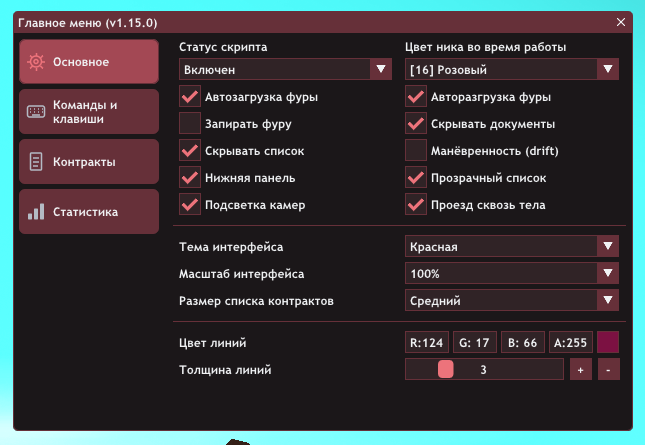
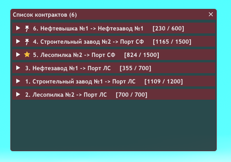
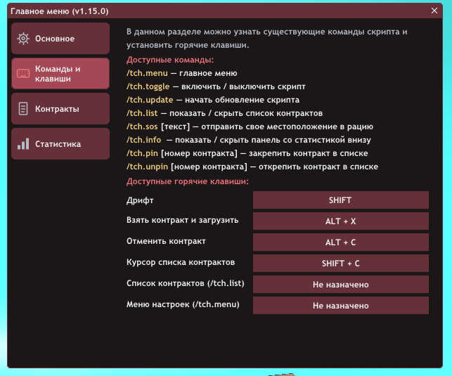
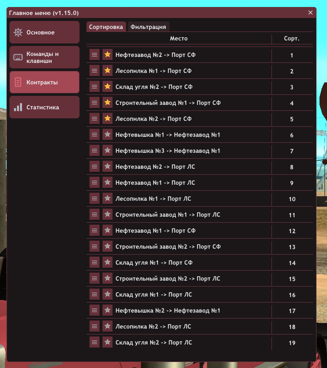
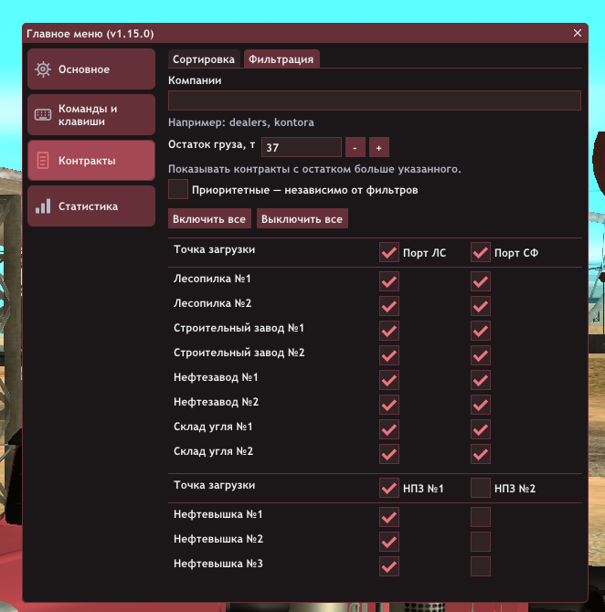
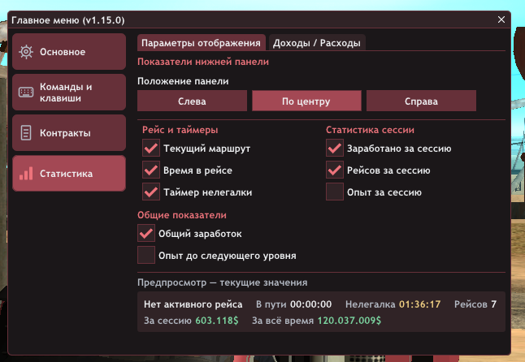
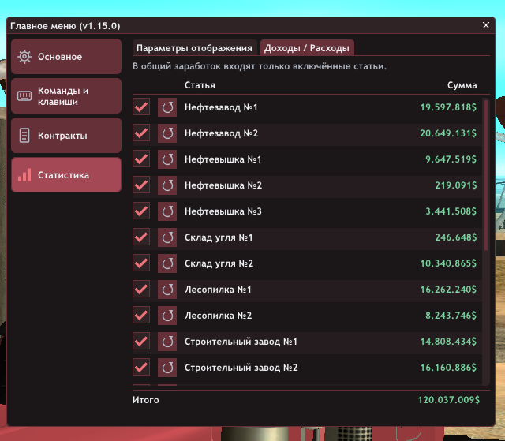

# Truck Contracts Helper

Помощник дальнобойщика для Evolve Role Play: контракты, загрузка и разгрузка, маршруты и статистика в одном интерфейсе MoonLoader.

**Версия: 1.16.0** · [Скачать архив](https://github.com/SamFredrickson/Truck-Contracts-Helper/releases/download/v1.16.0/tch-release-1.16.0.zip) · [История изменений](CHANGELOG.md)

## Возможности

- Кликабельный список контрактов с закреплением маршрутов и отметками приоритета.
- Автозагрузка и авторазгрузка фуры, автоматическое запирание дверей и смена цвета ника.
- Сортировка маршрутов перетаскиванием и фильтры по компании, остатку груза и направлению.
- Семь цветовых тем и масштаб интерфейса от 100% до 150%.
- Нижняя панель с маршрутом, таймерами, числом рейсов, заработком и опытом; расположение слева, по центру или справа.
- Учёт доходов и расходов с выбором учитываемых статей и подтверждением обнуления.
- Настраиваемые горячие клавиши, подсветка камер, улучшенная манёвренность и отправка координат в рацию.

Заработок и число рейсов за сессию сохраняются после `/rec` и перезапуска TCH. Новый запуск GTA начинает новую сессию. Общая статистика хранится отдельно.

## Установка

1. Установите зависимости, если их ещё нет в вашей сборке игры.
2. [Скачайте tch-release-1.16.0.zip](https://github.com/SamFredrickson/Truck-Contracts-Helper/releases/download/v1.16.0/tch-release-1.16.0.zip).
3. Распакуйте содержимое в папку `moonloader` в каталоге игры. Файл `tch-main.lua` должен находиться прямо в `moonloader`, папка `tch` — рядом с ним.
4. Запустите игру и откройте меню командой `/tch.menu`.

### Зависимости

- [SA-MP 0.3.7 R1](http://files.sa-mp.com/sa-mp-0.3.7-install.exe).
- [CLEO 4](https://cleo.li).
- [SAMPFUNCS 5.4.1](https://www.blast.hk/threads/17/).
- [MoonLoader 0.26.5](https://www.blast.hk/threads/13305/).
- [mimgui](https://github.com/THE-FYP/mimgui/releases/download/v1.7.0/mimgui-v1.7.0.zip): папку `mimgui` поместите в `moonloader/lib`.
- Библиотеки Lua, используемые скриптом, в том числе SAMP.Lua (`samp.events`).

В сборке с лаунчером необходимые компоненты могут быть уже установлены.

## Обновление

Введите `/tch.update`: скрипт проверит актуальную версию и предложит ссылки на архив и список изменений. Архив скачивается и устанавливается вручную.

Распакуйте новую версию в `moonloader` с заменой файлов, затем перезагрузите скрипты сочетанием `Ctrl + R` или перезапустите игру. Не удаляйте `moonloader/config/tch`: там находятся ваши настройки и статистика. Релизный архив не содержит пользовательских конфигураций.

## Команды и горячие клавиши

| Команда | Действие |
|---|---|
| `/tch.menu` | Главное меню |
| `/tch.toggle` | Включить или выключить скрипт |
| `/tch.update` | Проверить обновление и получить ссылку на архив |
| `/tch.list` | Показать или скрыть список контрактов |
| `/tch.info` | Показать или скрыть нижнюю панель |
| `/tch.pin [номер]` | Закрепить контракт |
| `/tch.unpin [номер]` | Открепить контракт |
| `/tch.sos [текст]` | Отправить своё местоположение в рацию |

Горячие клавиши назначаются в разделе «Команды и клавиши». Бинды открытия списка и меню по умолчанию не назначены.

## Интерфейс

Скриншоты сделаны перед повышением номера версии: в заголовках ещё указано 1.15.0, но показан интерфейс релиза 1.16.0.

### Основное

Тема, масштаб, размер списка и основные функции скрипта. Выбор сохраняется в настройках.



### Список контрактов

Золотая звезда обозначает приоритетный маршрут, значок булавки — закреплённый контракт. Доступны большой, средний и компактный варианты списка.



### Команды и клавиши



### Сортировка

Перетаскивайте маршрут за три полоски слева. Линия показывает место вставки. Нажатие на звезду переключает приоритет: золотая — включён, серая — выключен.



### Фильтрация

Укажите компании через запятую, задайте порог остатка груза и выберите направления. Контракты показываются с остатком **больше** указанного значения. Галочки в заголовках таблиц переключают целый столбец. При включённом исключении приоритетные маршруты отображаются независимо от фильтров.



### Нижняя панель

Выберите положение и нужные показатели. Предпросмотр использует текущие значения. Если показатели не помещаются в одну строку, панель переносит их на следующую.




### Доходы и расходы

Галочка включает статью в общий заработок. Кнопка рядом обнуляет сумму после подтверждения. Отключённые статьи сохраняют свои значения, итог виден под списком.



## Для разработчиков

Клонируйте проект в `moonloader/tch`, затем скопируйте `tch-main.lua` на уровень выше, в `moonloader`. Для разработки используется ветка `dev`, опубликованные версии находятся в `master`.

```sh
git clone --branch dev https://github.com/SamFredrickson/Truck-Contracts-Helper.git tch
cp tch/tch-main.lua .
```

Lua-файлы проекта содержат строки в кодировке Windows-1251. Сохраняйте эту кодировку при редактировании.

## Обратная связь

- [Сообщить об ошибке на GitHub](https://github.com/SamFredrickson/Truck-Contracts-Helper/issues/new).
- [Профиль на BlastHack](https://www.blast.hk/members/519123/).
